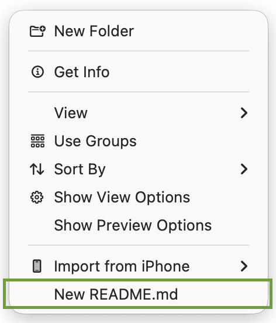

# New README.md for Finder

Adds a "New README.md" option to the macOS Finder context menu.
It creates an empty `README.md` in the current folder and never overwrites an existing one.

## How it works

There are two independent pieces:

| Piece | Where it shows up | Source |
|---|---|---|
| Finder Sync extension | Right-click on the empty background of a Finder window | `App/`, `Extension/`, `project.yml` |
| Quick Actions (Automator) | Right-click on files/folders, and the ⌃⌥⌘N shortcut | `QuickActions/` |

The extension is needed because Quick Actions cannot add items to the background context menu.

## Install

- Extension: run `./install.sh` (requires Xcode, `xcodegen` and an Apple Development certificate).
- Quick Actions: `cp -R QuickActions/*.workflow ~/Library/Services/`

See [install-in-another-macbook.md](install-in-another-macbook.md) for the full steps.
